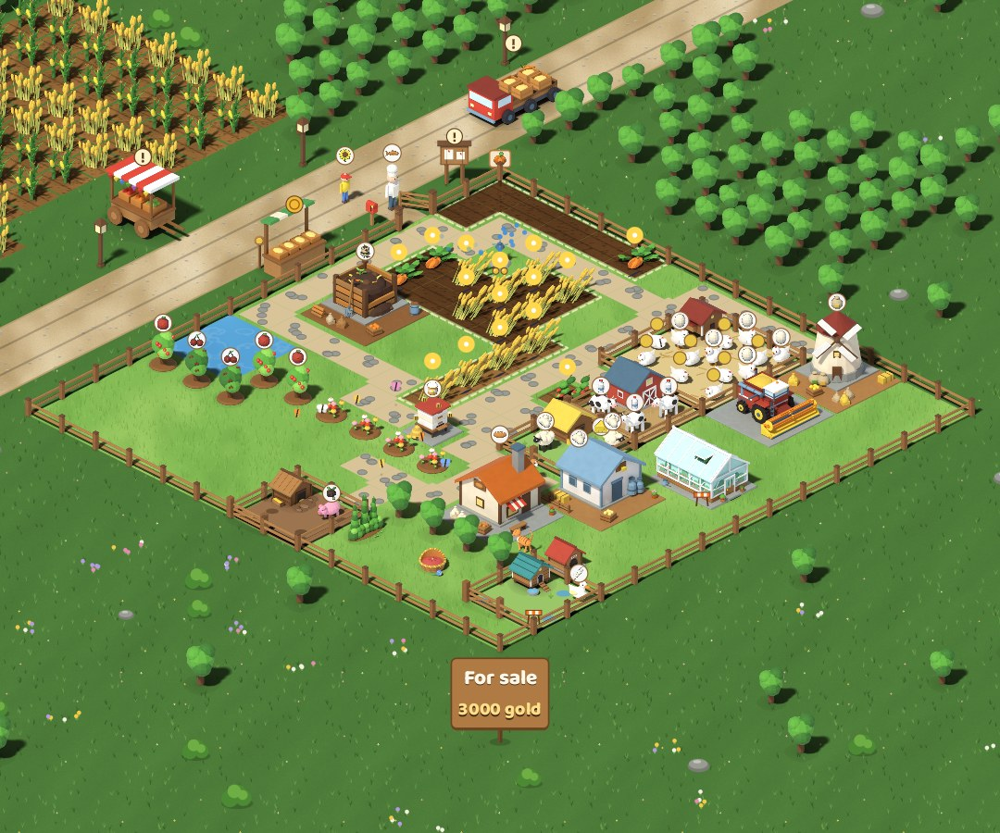
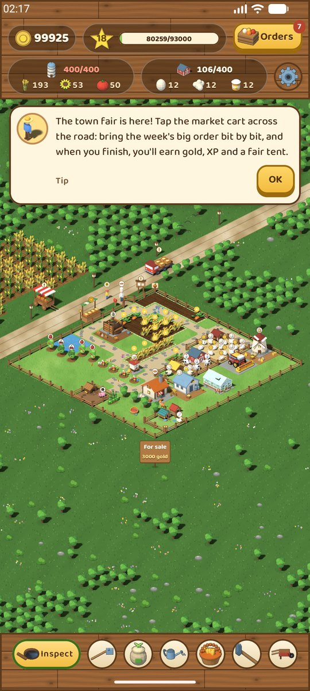
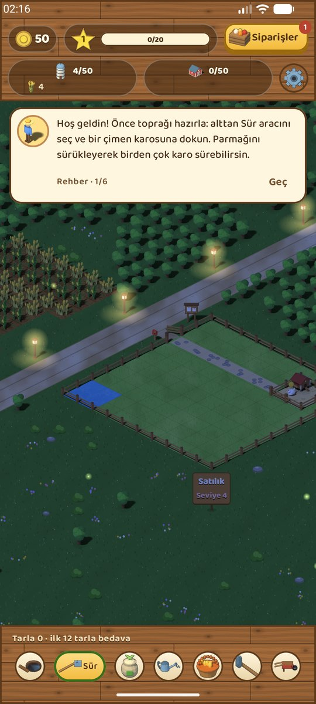

# PocketFarm

**Cebinde küçük bir çiftlik.** Toprağı sür, tohum ek, hayvanlarına bak, fırında ekmek pişir ve siparişleri yetiştir. Köylüler kapına gelir, kargalar ekinine göz diker, akşam olunca fenerler yanar. Acele yok, reklam yok; oyun sen yokken de yavaş yavaş büyümeye devam eder.

  
  &nbsp;&nbsp;
  

## İndir

En yeni sürüm [**Releases**](https://github.com/serkantkn/PocketFarm/releases) sayfasında.

| Cihaz | Dosya | Gereken |
|---|---|---|
| Android telefon ve tablet | `PocketFarm-<sürüm>.apk` | Android 9 veya üstü |
| Mac | `PocketFarm-<sürüm>-mac.dmg` | Apple çipli Mac (M1 ve sonrası) |

iPhone ve iPad sürümü hazır ama App Store / TestFlight'a çıkana kadar buradan dağıtılamıyor.

## Oyunda neler var

- **18 seviye.** Buğday ve tavukla başlarsın; sonra inek ve ahır, fırın, yem değirmeni, mandıra, pastane, koyun ve ağıl, keçi, domuz ve ördek, ayçiçeği ve yağhane, arı kovanı, mutfak, dokuma tezgâhı, iskele ve balık, meyve ağaçları ve reçel kazanı gelir.
- **Gerçek bir yer gibi.** Çiftliğin bir yolun kenarında, komşu tarlanın ve göl kıyısının yanında durur. Gün ışığı saatine göre değişir, yağmur yağar, ördekler gölde yüzer.
- **İnsanlar.** Siparişler, yoldan geçen kamyon, kapına gelen köylüler, köy panosundaki hikâyeler, haftalık panayır ve mevsimlik şenlikler.
- **Çiftlik düzeni senin.** Binaları istediğin yere kur, taşı, kaldır. Yollar önemli: yola bağlı olmayan bina yarı hızda çalışır. Arazi büyüdükçe çit de seninle büyür.
- **Sen yokken.** Ürünler hazır olunca bildirim gelir. Uzun süre uğramazsan dönüşte neler olduğunun kısa bir özeti ve küçük bir hediye seni bekler.
- **Bulut kaydı.** İstersen Play Oyunlar, Google ya da Apple hesabınla giriş yap; çiftliğin telefon, tablet ve Mac arasında seninle gelir. Giriş yapmadan da her şey oynanır.
- **Altı dil:** Türkçe, English, Français, Deutsch, Español, Italiano.

Bütün binalar, hayvanlar, köylüler ve simgeler Blender'da modellenip aynı ışıkla render edildi; oyun bu yüzden her ekranda aynı el yapımı görünümü taşır.

## Gizlilik

Reklam, analiz ve izleme yok. Giriş yapmazsan çiftliğin yalnızca cihazında durur. Giriş yaparsan çiftlik kaydın, seviyen, altının ve cihazının adı hesabına bağlı olarak Google Firebase'de saklanır; hesabını ve buluttaki kaydını istediğin an Ayarlar'dan silebilirsin. Oyun ayrıca saat ileri alınarak hile yapılmasın diye açılışta internetten saati sorar.

## Hata ve öneri

Bir sorunla karşılaşırsan ya da aklına bir fikir gelirse [bir issue aç](https://github.com/serkantkn/PocketFarm/issues). Hangi cihazda ve hangi sürümde olduğunu yazman çok yardımcı olur.

Bu depo sürümleri ve geri bildirimi taşır; oyunun kaynak kodu ayrı ve gizli tutuluyor.

---

## English

**A small farm in your pocket.** Till the soil, plant seeds, look after your animals, bake bread and fill orders. Villagers come to your gate, crows eye your crops, and lamps light up in the evening. No rush and no ads; the farm keeps growing slowly while you are away.

- **18 levels**, from wheat and chickens to cows, sheep, goats, pigs, ducks, a dairy, a bakery, a pastry shop, sheep, a beehive, a kitchen, a loom, a fishing dock, fruit trees and a jam kettle.
- **A living place:** a road, a neighbour's field, a lake, daylight that follows your clock, rain and ducks.
- **People:** orders, a passing truck, villagers at your gate, stories on the village board, a weekly fair and seasonal festivals.
- **Your layout:** build, move and remove freely; buildings off the road network run at half speed.
- **Cloud save** with Play Games, Google or Apple, across Android, iPhone, iPad and Mac. Optional; everything works without an account.
- **Six languages:** Turkish, English, French, German, Spanish, Italian.

Download from [Releases](https://github.com/serkantkn/PocketFarm/releases): the APK for Android 9 and later, the DMG for Apple silicon Macs. No ads, analytics or tracking; if you sign in, your save, level, coins and device name are stored in Google Firebase under your account, and you can delete both from Settings. Please [report problems](https://github.com/serkantkn/PocketFarm/issues).
